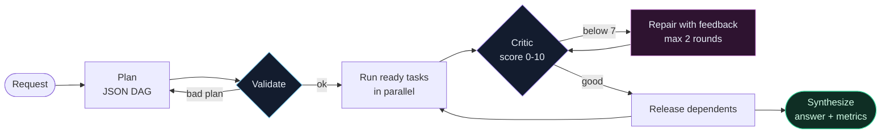
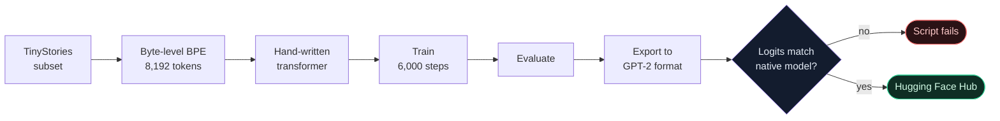

 

 

## 👋 Hi, I'm Sanjay

I'm an early-career AI engineer, and I'm upfront about that. I make up for it by **building every layer myself, testing it, and writing down where it breaks.**

A wrong model is normal. A system that is wrong **and looks fine** is the real risk. So I build LLM systems where failure is visible and bounded:

- 🔢 **Retries are counted**, not hidden
- 🏷️ **Partial results are labelled** as partial
- 💸 **Budgets are capped**, so nothing runs away
- 🧪 **Evals say what they don't prove**, not just what they do

 

## 🔴 Silent failure vs 🟢 Honest failure

| Situation | 🔴 Typical demo | 🟢 How I build it |
|---|---|---|
| Weak model output | Shipped as if fine | A critic reviews it and repairs it with targeted feedback |
| Transient errors | Crash, or retry invisibly | Only transient errors retry, with backoff, and every retry is counted |
| A task dies | Answer looks complete anyway | Dependents are skipped and the result is labelled partial |
| Cost and calls | Unbounded | Hard call budget plus a deadline |
| "It works" | One happy-path demo | Deterministic simulator with seeded fault injection |
| Eval numbers | Quoted without context | Each README states what they prove, and what they don't |

 

## 🚀 What I've built

<table>
<tr>
<td width="33%" valign="top">

### 🦀 rapTOR
**Agents that fail honestly**

Plans a request into a validated dependency graph, runs tasks in parallel, and has a critic review and repair every result.

`Rust` `Python` `Ollama`

**[View repo →](https://github.com/kcsanjayj/rapTOR)**

</td>
<td width="33%" valign="top">

### 🍝 Spaghetti
**Private document Q&A**

Chat with your own PDFs and DOCX on your own laptop. Streaming answers with citations. No cloud, no accounts, no API keys.

`Python` `Rust` `JavaScript`

**[View repo →](https://github.com/kcsanjayj/Spaghetti)** · **[Live UI →](https://spaghetti.kcsanjayj.workers.dev)**

</td>
<td width="33%" valign="top">

### 🧠 TinyGPT-X
**A GPT from scratch**

A 13.9M-parameter transformer in PyTorch, trained from random initialization on one 6 GB laptop GPU. No pretrained weights.

`PyTorch` `Hugging Face`

**[View repo →](https://github.com/kcsanjayj/TinyGPT-X)** · **[Model →](https://huggingface.co/kcsanjayj/TinyGPT-X)**

</td>
</tr>
</table>

 

### 🦀 rapTOR · A multi-agent orchestrator you can trust to fail honestly

My first version looked fine and was broken: tasks never received their dependencies' outputs, the critic skipped the last step, and `9**9**9` hung the calculator. I reviewed it honestly, rewrote it, and **all 8 defects now have regression tests that fail if they return.**

- ✅ **63 Rust tests, 6 Python tests and 26 deterministic end-to-end evals**, in CI on Ubuntu and Windows
- 🧪 **Seeded fault injection** (transient 503s, weak drafts, permanent failures) makes recovery reproducible
- 🪶 **4 direct Rust dependencies.** The plan validator, calculator and parsers are hand-written and bounded
- 🔒 **Local only by design:** remote model endpoints are rejected

 

### 🍝 Spaghetti · Chat with your documents, privately

Five small "agents" plan, search, write, check and serve each answer using a model running locally through Ollama.

- 🎯 **Measured, not guessed.** The relevance filter was chosen from an ablation: **abstention 0.8 → 1.0 with no loss in retrieval**
- ⚙️ **Rust core with a Python twin.** Chunking, BM25 and ranking are in Rust, with a pure-Python equivalent and parity tests, so Rust stays optional
- 💬 **Streaming chat** with stop, regenerate, citations and saved history
- 📊 **87 tests, a 28-case evaluation harness with CI gates, 19 browser end-to-end checks, and 0 axe-core accessibility violations** in light and dark
- ⚡ **Worst frame 17 ms while streaming** (headless Chromium)
- 🔐 **Security by allowlist:** strict Content-Security-Policy, exact-origin CORS, model downloads limited to a built-in menu

> **Honest note from the repo:** the eval mock is extractive, so its perfect scores prove plumbing and retrieval, not model quality. I haven't verified a real Ollama install, real model speed or Safari. It uses BM25, not embeddings, so synonyms are a known limitation with two eval cases documenting it on purpose.

 

### 🧠 TinyGPT-X · A language model, built from nothing

| **13.9M** | **6.05** | **11.3 min** | **2.02 GB** | **56.2%** |
|:---:|:---:|:---:|:---:|:---:|
| parameters | best val. perplexity | training time | peak GPU memory | next-token top-1 |

- 🏗️ **Transformer, tokenizer and training loop written by hand.** The vocabulary is learned from the training text, with no pretrained weights anywhere
- 🔬 **Verified, not assumed:** tests prove causality, hand-written attention equal to the fused kernel, and CPU-vs-GPU agreement
- 📦 **Export is checked.** The exported GPT-2-format model's logits are compared to the native model, and the script fails if they differ
- 🧾 **Every number in the README is generated** from a real run by a script, not typed by hand

> **Honest note from the repo:** it only knows simple children's stories. It won't answer questions or follow instructions, and it repeats over longer outputs.

 

## 🧭 How I work

| Principle | In practice |
|---|---|
| 👁️ **Make failure visible** | Retries counted, partials labelled, budgets capped |
| 🧪 **Test the machinery** | Simulators and fault injection turn "it recovered once" into something reproducible |
| 📏 **Measure before tuning** | An ablation changed my threshold. I write the eval harness before trusting a number |
| 🪞 **Review my own work** | I audited my own v1, found 8 defects, and gave each a regression test |
| 🛟 **Keep a fallback** | Every native component has a pure-Python twin and parity tests |
| 📝 **State the limits** | Every README has an "honest limitations" section |

 

## 🛠️ Toolbox

 

## 🔭 What I'm working on now

- 🧪 Running rapTOR against real local models and tuning the planner prompts
- 🔎 Adding embedding-based retrieval to Spaghetti behind the existing ranking interface
- 📈 Next for rapTOR: model-graded evals with variance reporting, and per-task timeouts with cancellation

 

## 🤝 Let's talk

I'm looking for **AI and ML engineering roles** where reliability matters and someone would rather hear about a limitation from me than find it in production.

  

