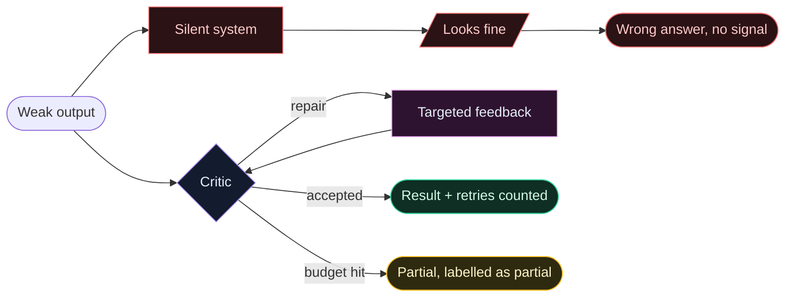

<div align="center">


<br/>

<a href="mailto:kcsanjayj@gmail.com"></a>
<a href="https://linkedin.com/in/kcsanjayj"></a>
<a href="https://huggingface.co/kcsanjayj"></a>

</div>

<br/>

## 🎯 The idea

A model that is wrong is normal. A system that is wrong **and looks fine** is the real problem.

I build LLM systems where failure is a first-class, visible outcome: validated plans, critics that review output, bounded retries and budgets, and evals that say plainly what they do *and don't* prove.

I'm early-career, and I learn each layer from first principles: build it, test it, document its limits.

<br/>

## 🔴 Silent failure vs 🟢 Honest failure

| Situation | 🔴 Typical system | 🟢 How I build it |
|---|---|---|
| Weak model output | Shipped as if it were fine | A critic reviews it, then repairs it with targeted feedback |
| Retries | Happen invisibly | Counted and reported |
| Partial results | Presented as complete | Labelled as partial |
| Cost and calls | Unbounded | Budgets capped |
| Evals | "It works" | Each README states what the evals prove, and what they don't |
| Recovery | Hard to reproduce | Deterministic simulators and fault injection make it repeatable |



<details>
<summary><b>What "fails honestly" looks like (illustrative sketch)</b></summary>

```text
task: summarise_report      status: PARTIAL
  attempts ........ 3 / 3   (budget exhausted)
  critic verdict .. weak: missing citation for claim 2
  output .......... returned, labelled partial
  note ............ not retried further; no silent fallback
```

</details>

<br/>

## 📊 By the numbers

<div align="center">

| **63** | **26** | **87** | **13.9M** | **6.05** |
|:---:|:---:|:---:|:---:|:---:|
| Rust tests in rapTOR | deterministic e2e evals | tests in Spaghetti | params, trained from scratch | val. perplexity on TinyStories |

</div>

<br/>

## 🚀 Selected Projects

### 🦀 [rapTOR](https://github.com/kcsanjayj/rapTOR) · Multi-agent orchestrator

Plans a request into a validated dependency graph, runs independent tasks in parallel, reviews each result with a critic, and repairs weak output with targeted feedback. Runs fully offline against a local model or a seeded simulator with fault injection.

- ✅ 63 Rust tests and 26 deterministic end-to-end evals, in CI on Ubuntu and Windows
- 🔁 Rewritten after a self-review found eight defects; each now has a regression test
- 🪶 Four direct dependencies; plan validator, calculator and parsers are hand-written and bounded

`Rust` `Python` `GitHub Actions` `Ollama`

<br/>

### 📚 [Spaghetti](https://github.com/kcsanjayj/Spaghetti) · Local document Q&A (RAG)

Ask questions over PDF, DOCX and text files using a model on your own machine: streaming answers with citations, no cloud, no API keys. [Live UI](https://spaghetti.kcsanjayj.workers.dev) *(chat needs the local backend)*.

- 🎯 Relevance threshold chosen by ablation: abstention up from 0.8 to 1.0, no loss in retrieval
- ⚙️ Rust core for chunking and ranking, with a pure-Python twin and parity tests
- ♿ 87 tests, a 28-case eval harness, zero axe-core accessibility violations

`Python` `Rust` `JavaScript` `BM25` `Ollama`

<br/>

### 🧠 [TinyGPT-X](https://github.com/kcsanjayj/TinyGPT-X) · A language model from scratch

A 13.9M-parameter decoder-only transformer in PyTorch, trained from random init on a single 6 GB laptop GPU in about 11 minutes. Published on the [Hugging Face Hub](https://huggingface.co/kcsanjayj/TinyGPT-X) in GPT-2 format.

- 📉 Validation perplexity 6.05 on TinyStories
- 🔬 Exported logits verified against the native implementation
- 🧪 Tests for causality, attention equivalence and export parity

`PyTorch` `Python` `Hugging Face`

<br/>

## 🛠️ Toolbox

<div align="center">


</div>

<br/>

## 🔭 Currently

- Evaluating rapTOR against local models and tuning planner prompts
- Adding embedding-based retrieval to Spaghetti behind its existing ranking interface

<br/>

<div align="center">

### 🟢 Open to AI and ML engineering roles

<a href="mailto:kcsanjayj@gmail.com">kcsanjayj@gmail.com</a> · <a href="https://linkedin.com/in/kcsanjayj">linkedin.com/in/kcsanjayj</a>


</div>
